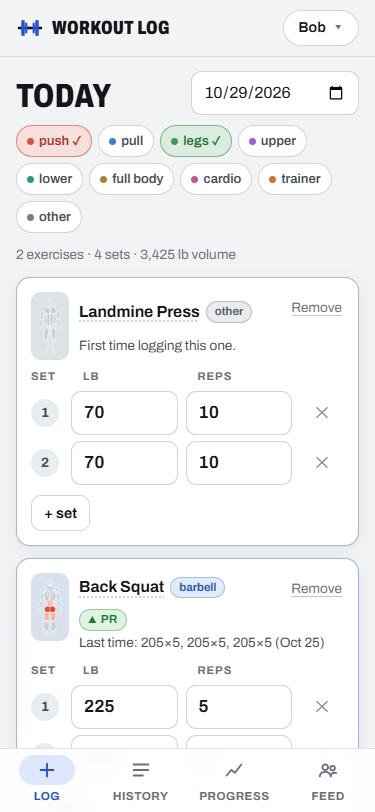

# Workout Log

A free workout tracker for a small group of friends (built for up to ~6 people). Everyone
logs their own lifts from their phone, and everyone can see everyone else's progress.

- **Log**: today's workout (or any date). Add exercises from a searchable list, log sets as
  weight (lb) × reps, use "+ set" to copy the previous set, and see "Last time: 135×8, 135×8 (Oct 21)"
  under each exercise. A **PR** badge appears when your top set beats your previous best.
  Tag the day (push, pull, legs, upper, lower, full body, cardio, trainer, other); a day with
  only tags or a note (say, a cardio session) is saved too.
- **History**: your workouts, newest first, filterable by tag. Tap to expand and see a map of
  every muscle that day hit, Edit (opens it in Log), Delete.
- **Progress**: a chart per exercise of top-set weight and estimated 1RM (Epley) over time,
  plus best set, best e1RM, session count and last date. Switch the person to view a friend.
- **Feed**: everyone's recent workouts with top sets, tags and PRs. Tap a name to see their progress.
- **How-to sheet**: tap any exercise name (or the little body figure on a Log card, or the ⓘ in
  the exercise list) for start/finish photos, numbered instructions, a front/back muscle map
  (main muscles bright, helper muscles faint) and buttons that search **YouTube Shorts** and
  **TikTok** for form videos. Exercises you add yourself get the map (pick the muscles when you
  create them) and the video links.



More screenshots: [History](docs/screenshots/history.png),
[how-to sheet](docs/screenshots/exercise-detail.png) ([dark](docs/screenshots/exercise-detail-dark.png)),
[Progress](docs/screenshots/progress.png).

Weights are in **pounds**. Every exercise has an **equipment type** (barbell, dumbbell,
machine, smith, cable, bodyweight, kettlebell, band, other) shown as a badge. The same movement on
different equipment is a separate exercise ("Bench Press · barbell" and "Bench Press · smith"
are tracked separately). You can add your own exercises from the Log screen.

It is plain HTML, CSS and JavaScript with no build step, hosted for free on **GitHub Pages**,
with data stored in a free **Supabase** (Postgres) project.

---

## How identity works (read this)

There are **no passwords**. The first screen asks "Who are you?" and you tap your name (or add
yourself). Your choice is remembered on that device.

That means **anyone who has the site URL can see and edit all data**, including logging as
someone else or deleting workouts. The Supabase "anon" key in `config.js` is public by design and
the database policies allow it to read and write everything. This is a deliberate trade-off for a
trusted group of friends. Don't share the URL publicly and don't store anything sensitive in it.

---

## Try it locally first (optional, no setup)

With `config.js` left empty the app runs in **local mode**: data is saved in your browser's
localStorage on that one device, and a "Local mode" badge shows at the bottom of the page.

ES modules don't load from `file://`, so serve the folder over HTTP:

```
cd workout
python -m http.server 8000
```

Then open <http://localhost:8000>. (Any static server works.)

Local mode data is not copied to Supabase when you switch over; it is only for trying things out.

---

## Supabase setup (one time, about 5 minutes)

1. Go to <https://supabase.com>, sign up (free), and click **New project**. Pick any name, any
   region close to you, and any database password (you won't need it for this app). Wait for the
   project to finish setting up.
2. In the left sidebar open **SQL Editor** → **New query**. Open `schema.sql` from this folder,
   copy **all** of it, paste it in, and click **Run**. You should see "Success. No rows returned".
   This creates the tables, the access policies and about 40 starter exercises.
   (It is safe to run again later; it won't duplicate anything.)
3. Get your two connection values:
   - **Project URL**: Project Settings → **Data API** (or the **Connect** button at the top of the
     dashboard). It looks like `https://abcdefghijklmno.supabase.co`.
   - **Public key**: Project Settings → **API Keys**. Use the **anon public** key (under "Legacy
     API keys", a long string starting with `eyJ...`) or the **publishable** key
     (`sb_publishable_...`). Either works.
     **Never** use the `service_role` / secret key.
4. Open `config.js` and paste them in:

   ```js
   export const SUPABASE_URL = "https://abcdefghijklmno.supabase.co";
   export const SUPABASE_ANON_KEY = "eyJhbGciOi...";
   ```

5. Reload the app. The "Local mode" badge disappears, and data is now shared by everyone.

To check it worked: in Supabase open **Table Editor** → `exercises`; you should see the seeded rows.

**Already ran an older `schema.sql`?** Run the whole current file again (SQL Editor → paste →
Run). It is written to be re-run: it adds the new `exercises.muscles` and `workouts.tags`
columns if they're missing, (re)creates their check constraints, and fills in the muscle list
for the built-in exercises. Nothing is deleted.
After someone adds their name in the app, it shows up in `users`.

**Free tier note:** Supabase pauses free projects after about a week with no activity. Your data
is kept; open the Supabase dashboard and click **Restore project**, then the app works again.
If the app shows "Can't reach Supabase", this is the most likely reason.

---

## Publish on GitHub Pages (on your other GitHub account)

1. Sign in to the GitHub account you want to use and create a **new public repository**,
   e.g. `workout`. (GitHub Pages on a free account requires a public repo.)
2. Upload the files. Either:
   - **Web upload:** on the empty repo page click **uploading an existing file** (or
     **Add file → Upload files**), drag in everything in this folder (`index.html`,
     `styles.css`, `config.js`, `schema.sql`, `README.md`, `.gitignore` and the whole `js` folder
     with its `views` subfolder), and click **Commit changes**. Make sure `js/views/` keeps its
     folder structure.
   - **Or with git** from this folder (already a git repo with one commit):
     ```
     git remote add origin https://github.com/<account>/workout.git
     git branch -M main
     git push -u origin main
     ```
3. In the repo go to **Settings → Pages**. Under **Build and deployment**, set **Source** to
   **Deploy from a branch**, choose branch **`main`** and folder **`/ (root)`**, and click **Save**.
4. After a minute or two the site is live at `https://<account>.github.io/workout/`
   (the Pages settings page shows the exact link). Share that link with your group.

Whenever you change a file (for example `config.js`), upload or push it again; Pages redeploys
automatically in a minute or so. If you see old content, do a hard refresh.

Tip: on a phone, open the site and use "Add to Home Screen" so it opens like an app.

---

## Files

| File | What it is |
|---|---|
| `index.html` | The single page: "Who are you?" screen, four tabs, footer badge, toast. |
| `styles.css` | Mobile-first styles; colors are CSS variables with a dark-mode override. |
| `config.js` | Supabase URL + public key. Empty = local mode. |
| `js/app.js` | Boot, user picker, tab routing, re-fetch when the tab or app regains focus. |
| `js/views/log.js` | Log view (sets, "+ set", "Last time", PR badge, notes). |
| `js/views/history.js` | History view. |
| `js/views/progress.js` | Progress view (stats, chart, data table). |
| `js/views/feed.js` | Group feed. |
| `js/picker.js` | Exercise picker dialog and "New exercise" form. |
| `js/chart.js` | Small SVG line chart with tooltip (no library). |
| `js/stats.js` | Pure math: Epley 1RM, top set, volume, PR detection. |
| `js/store.js` | Picks the storage adapter; documents the shared interface. |
| `js/store-supabase.js` | Supabase adapter (supabase-js v2 from esm.sh). |
| `js/store-local.js` | localStorage adapter used in local mode. |
| `js/exercises-seed.js` | Starter exercise list with main/helper muscles (mirrored in `schema.sql`). |
| `js/bodymap.js` | Front/back SVG body map with highlightable muscle regions. |
| `js/detail.js` | Exercise how-to sheet (photos, steps, muscle map, video search links). |
| `js/exercise-info.js` | Generated: photos + instructions for the starter exercises. |
| `tools/build-exercise-info.mjs` | Regenerates `js/exercise-info.js` (`node tools/build-exercise-info.mjs`). |
| `docs/screenshots/` | Screenshots used in this README. |
| `schema.sql` | Tables, constraints, RLS policies and seed exercises for Supabase. |

## Details

- **Top set** = heaviest set (ties go to more reps). **PR** = a session whose top set beats the
  top set of every earlier session for that person and exercise (the very first session isn't
  a PR). **Estimated 1RM** uses Epley, `weight × (1 + reps / 30)`; a single rep counts as the
  weight itself.
- One workout per person per day. It is created automatically when you add the first set, type
  a note, or tag the day. It is removed again only when it has no sets, no note and no tags.
- Bodyweight exercises: leave weight empty (0) for bodyweight only, or enter added weight in lb.
  If an exercise has only 0 lb sets, Progress charts reps instead of weight.
- Deleting a workout deletes its sets. Deleting a user (from the Supabase Table Editor) deletes
  their workouts. Exercises that have logged sets can't be deleted, so history is never lost.
- To rename someone or remove a mistaken exercise, use Supabase **Table Editor**.
- Backups: in Table Editor you can export each table as CSV.

## Credits

Exercise photos and instructions come from
[free-exercise-db](https://github.com/yuhonas/free-exercise-db) by yuhonas, released into the
public domain (Unlicense). The app only ships the entries for its starter exercises
(`js/exercise-info.js`); the photos load from that project's GitHub on demand. Two starter
exercises use the closest movement the database has: Romanian Deadlift (dumbbell) shows
"Stiff-Legged Dumbbell Deadlift", and Kettlebell Swing shows "One-Arm Kettlebell Swings" (that
entry has no written steps, so the swing's four steps are our own). Typeface: Archivo, from
Google Fonts.
